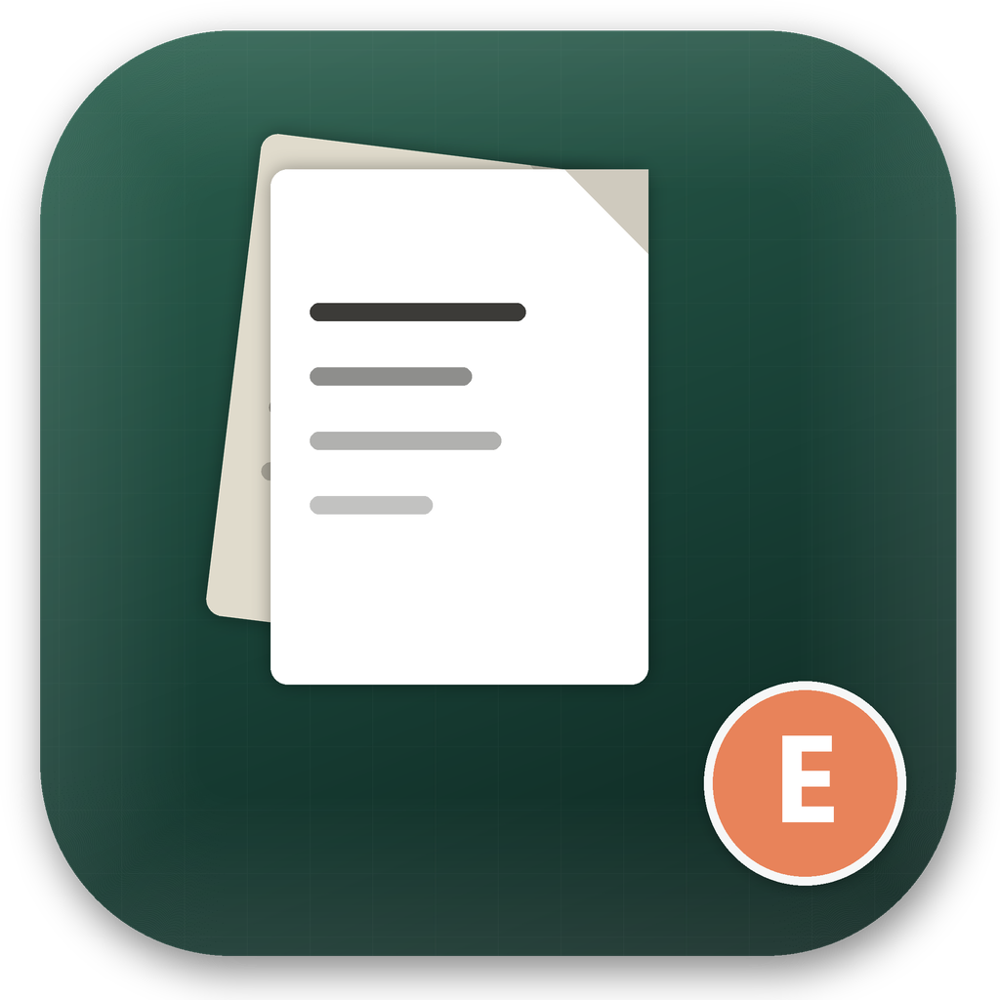
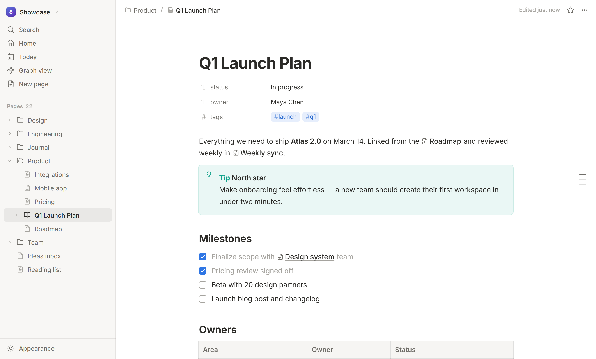
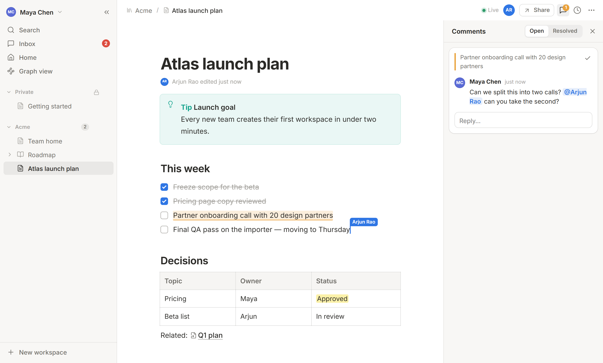

<p align="center"></p>
<h1 align="center">Local Notes Extended</h1>
<p align="center">A calm, Notion-style editor for plain markdown files — with wikilinks, backlinks, a graph view and templates.<br>Works with your Obsidian vault. Free for Windows, macOS and Linux.</p>



📖 **[Read the documentation](docs/README.md)** · 🌐 **[Website](https://harshid-lgtm.github.io/local-notes-extended/)** · 📝 **[Changelog](CHANGELOG.md)**

## Download

Get the latest installer from **[Releases](https://github.com/harshid-lgtm/local-notes-extended/releases/latest)**:

| Platform | File |
| --- | --- |
| Windows 10/11 | `Local-Notes-Extended-Setup-<version>-x64.exe` (or `-arm64.exe`) |
| macOS 11+ | `Local-Notes-Extended-<version>-mac.dmg` (Apple Silicon + Intel) |
| Linux | `Local-Notes-Extended-<version>-x86_64.AppImage` or `.deb` (Ubuntu/Debian) |
| Android / iOS | Installable PWA from your team server — [details](mobile/README.md) |

Installed apps update themselves when a new release is published.

> Early builds aren't code-signed. On Windows choose **More info → Run anyway**; on macOS right-click the app and choose **Open** the first time.

## Features

- **Invisible markdown** — headings, checklists, tables, callouts, code, images and inline text styles render as you type. Files stay clean markdown.
- **Text size and colour** — select text, then use **Aa** for Small/Normal/Large/Huge or **A** for a text colour. Sizes and colours are saved as inline CSS in the markdown.
- **Automatic links** — bare `http://` and `https://` URLs become links when a note opens, or when you type or paste them. The **Link** dialog edits or removes them.
- **Open files, not just notes** — PDFs, Word `.docx` documents, text files, images and media appear in the folder tree and open in a read-only preview. Other files open in their default app.
- **Slash commands, drag handles and a formatting toolbar**, Notion-style.
- **Wikilinks & backlinks** — type `[[` to link; every page lists what links to it, plus unlinked mentions.
- **Graph view** — an interactive map of your vault, coloured by folder, with a local graph per page.
- **Wiki structure** — nest pages inside pages (stored as `Page.md` + `Page/`), breadcrumbs, subpage lists and a floating outline.
- **Templates & daily notes** — `{{title}}`, `{{date}}`, `{{time}}` variables; uses Obsidian's template and daily-note settings when present.
- **Ranked full-text search** — an incremental index over titles and bodies with prefix matches, typo tolerance and BM25-style ranking. `Ctrl/⌘ K`.
- **Export anywhere** — Word (`.docx`), PDF, HTML, plain text and Markdown, with headings, lists, tables, code and local images. Desktop, browser and mobile.
- **Installable mobile app** — the same UI on Android and iOS as a PWA, with an offline app shell and offline search over recently opened pages. [Mobile details](mobile/README.md).
- **AI assistant** — rewrite, summarize and draft with AI, and *Ask your notes* with cited answers. Choose Claude, OpenAI, Gemini, any OpenAI-compatible API, or free local models via Ollama. Off until you turn it on. [Learn more](docs/ai.md).
- **Obsidian compatible** — callouts, embeds, tags, `==highlights==`, frontmatter, Windows line endings; files are only rewritten when you edit them, and round-trip byte for byte.

| Shortcut | Action |
| --- | --- |
| `Ctrl/⌘ K` | Search, commands (`>`), create pages |
| `Ctrl/⌘ J` | Ask AI |
| `Ctrl/⌘ G` | Graph view |
| `Ctrl/⌘ Alt N` | New page |
| `Ctrl/⌘ \` | Toggle sidebar |
| `/` | Insert a block |
| `[[` | Link a page |

## Development

Requires Node 20+.

```bash
npm install
npm run build      # bundle the UI into public/
npm run app        # run the desktop app
npm start          # or run in the browser at http://localhost:4321
npm run dist       # build installers for your current OS into dist/
node --test test/*.test.*   # search, permissions and export tests
```

Project layout:

- `src/` — the editor UI (TipTap/ProseMirror), bundled with esbuild into `public/`
- `server/core.js` — the local vault API (files, search, backlinks, graph, templates)
- `electron/` — the desktop shell (window, native dialogs, auto-update)
- `src/team/` — team mode: sign-in, shared workspaces, co-editing, comments, history, inbox
- `shared/search-index.cjs` — the ranked, typo-tolerant index used by the local and team servers
- `server/export.js` — shared DOCX/PDF/HTML/TXT/Markdown export
- `public/manifest.webmanifest`, `public/sw.js` — installable mobile/PWA shell
- `test/` — search, permissions and export tests (`node --test test/*.test.*`)
- `team-server/` — the self-hosted team server (REST + Yjs WebSocket + SQLite) and its Docker deploy kit
- `site/` — the landing page, published to GitHub Pages
- `.github/workflows/` — `release.yml` builds all installers when you push a `v*` tag; `pages.yml` publishes the site

### Releasing

```bash
npm version patch          # bumps package.json and creates a git tag
git push --follow-tags     # GitHub Actions builds Windows, macOS and Linux installers
```

## Teams

Run the **[Local Notes Extended team server](team-server/README.md)** (one Docker command with automatic HTTPS) and your team gets:

- **Shared workspaces** with owner / admin / editor / viewer roles and invite links, plus a **private space** for every person
- **Workspace admins** who can add members and grant or revoke admin rights; only owners can change ownership
- **Ranked team search** across every workspace and page shared with you, filtered on the server by access
- **Live co-editing** with presence and named cursors; edits merge cleanly, even after a dropped connection
- **Comments** on any text, threads, resolve, and **@mentions**
- **Version history** with named versions and one-click restore
- An **inbox** for mentions and replies, live sidebar updates, team-wide search, backlinks and graph
- A **markdown mirror** of every page on the server, in the same layout as a Local Notes Extended / Obsidian vault

Teammates connect from the desktop app (*vault menu → Connect to a team server*) or just open the server's address in a browser. For a server on your LAN, enter the address with its port, for example `http://192.168.1.48:3000`; private IPs are treated as HTTP automatically.



## Roadmap

- **Microsoft Teams** — a channel tab with Microsoft 365 sign-in.

## License

MIT
